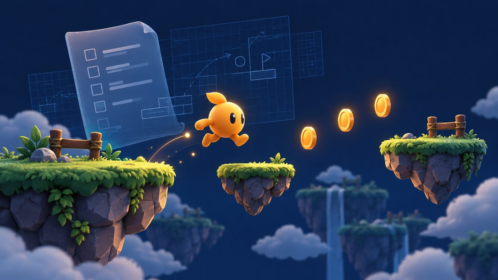

# JTW1



파일 기반 계획 워크플로우([ahastudio/file-based-planning-workflow](https://github.com/ahastudio/file-based-planning-workflow))를 따르는 점프 게임 실습 저장소입니다.

## 워크플로우

파일 시스템을 AI 에이전트의 영구 메모리로 사용합니다. 기능마다 `docs/<기능명>/` 폴더를 만들고 `templates/`의 문서를 복사해 채웁니다.

| 파일 | 역할 | 업데이트 시점 |
| ---- | ---- | ------------- |
| `README.md` | 기능 개요, 문서 색인 | 기능 정의 시 |
| `spec.md` | 요구사항 (무엇을) | Phase 1 |
| `plan.md` | 기술 구현 계획 (어떻게) | Phase 2 |
| `tasks.md` | 단계별 체크리스트 | Phase가 바뀔 때 |
| `findings.md` | 발견사항, 결정, 에러 상세 | 발견 즉시 |
| `progress.md` | 세션별 작업 로그 | 세션 종료 시 |

작업 전후로 `tasks.md`, `findings.md`, `progress.md`를 읽고 갱신합니다.

## 구조

```text
templates/          빈 문서 템플릿
docs/mario-jump/    점프 게임 기능 문서
mario-jump.html     2D 횡스크롤 (기본)
mario-jump-A.html   탑다운 (말포이)
mario-jump-B.html   1인칭
render-sfx.js       효과음을 sfx/*.wav 로 렌더링 (node render-sfx.js)
sfx/                렌더링된 효과음
```
